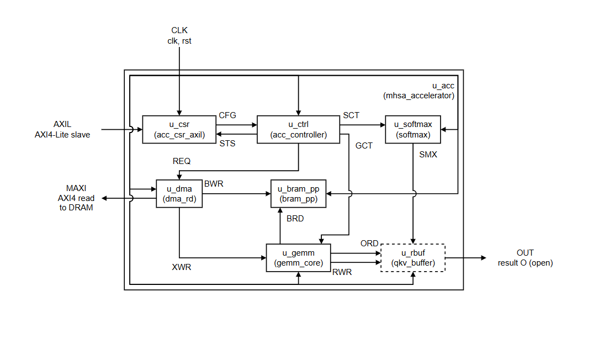

# MHSA Accelerator: spec chi tiết (v0.1, bản nháp để bạn sửa)

Viết ngày 2026-11-02. Tài liệu này gom lại những gì bạn đã chốt (kiến trúc 2026-10-30, DMA v0, bram_pp, GEMM của Minh) và lấp các chỗ còn trống bằng đề xuất của tôi. Chưa có RTL nào được viết theo tài liệu này; mọi con số chu kỳ và BRAM là **ước lượng tính tay**, chưa synth, chưa mô phỏng.

**Cách đọc nhãn**

| Nhãn | Nghĩa |
|---|---|
| **[CHỐT]** | Bạn đã quyết định rõ |
| **[CÓ SẴN]** | Khối đã có RTL (của bạn hoặc Minh), nhưng RTL không nằm trong project nên tên port ở đây là tên mô tả |
| **[GIẢ ĐỊNH]** | Tôi suy ra, cần bạn xác nhận |
| **[ĐỀ XUẤT]** | Tôi đề xuất, bạn chưa đồng ý hay bác |
| **MỞ-xx** | Câu hỏi còn mở, liệt kê đầy đủ ở §12 |

Muốn sửa chỗ nào thì cứ ghi đè lên bảng, hoặc ghi chú bên cạnh mã MỞ-xx, tôi sẽ cập nhật các phần liên quan cho khớp.

---

## Mục lục
1. Phạm vi và thông số
2. Tổng quan hệ thống và danh sách khối
3. Kiểu số và định dạng dữ liệu
4. Dataflow: thứ tự tính toán
5. Bộ nhớ on-chip: dung lượng và layout
6. Mô tả từng khối (chức năng, micro-architecture, port)
7. Controller FSM
8. CSR map
9. Giao thức handshake chung
10. Clock, reset, CDC
11. Hiệu năng ước lượng
12. Điểm mở và giả định
13. Kế hoạch kiểm thử và thứ tự làm

---

## 1. Phạm vi và thông số

### 1.1 Accelerator làm gì

Tính **một lớp Multi-Head Self-Attention chuẩn** (bidirectional, không mask) cho một activation X:

```
Q = X·Wq + bq        K = X·Wk + bk        V = X·Wv + bv          (S×768 mỗi cái)
với mỗi head h = 0..11:
    Score_h = Q_h · K_hᵀ / √64                                   (S×S)
    P_h     = softmax theo hàng(Score_h)                         (S×S)
    O_h     = P_h · V_h                                          (S×64)
Concat = [O_0 | O_1 | ... | O_11]                                (S×768)
Out    = Concat·Wo + bo   (+ X nếu bật residual)                 (S×768)
```

| Hạng mục | Giá trị | Nhãn |
|---|---|---|
| Kiểu lớp | MHSA chuẩn, self-attention, không phải full Transformer | [CHỐT] |
| D_MODEL | 768 | [CHỐT] |
| NUM_HEADS × HEAD_DIM | 12 × 64 | [CHỐT] |
| S (số token, số hàng của activation X) | runtime ≤ `PARA_S_MAX`; đề xuất `PARA_S_MAX = 128`, S là bội số 32 | [ĐỀ XUẤT], MỞ-01 |
| LayerNorm, FFN | nằm ngoài accelerator | [GIẢ ĐỊNH], MỞ-02 |
| Residual `+X` | có, bật/tắt bằng CSR | [ĐỀ XUẤT], MỞ-02 |
| Kiểu dữ liệu | INT8 cho X, W, Q, K, V, P, O; bias INT32; accumulator INT32 | [GIẢ ĐỊNH], MỞ-03 |
| FPGA | Xilinx VC707 (xc7vx485t): 1030 BRAM36, 2800 DSP48E1 | [CHỐT] |
| Clock mục tiêu | 200 MHz (control plane đã đạt WNS +0.548 ns ở 200 MHz) | [GIẢ ĐỊNH], MỞ-10 |
| Chế độ chạy v0 | tuần tự: nạp xong mới tính | [CHỐT] |

### 1.2 Không làm trong v0
- Không mask (causal), không cross-attention, không KV cache.
- Không ghi về DRAM bằng DMA (DMA chỉ đọc) [CHỐT]. Cách lấy kết quả ra: xem §6.9 và MỞ-07.
- Không overlap DMA với compute (cấu trúc đã sẵn sàng nhờ bram_pp, bật ở v1, xem §7.4).

---

## 2. Tổng quan hệ thống và danh sách khối

### 2.1 Mức SoC [CÓ SẴN]

```
 VexRiscv ──dBus──▶ dbus_decoder ──▶ DMEM (0x0000_xxxx)
                         └────────▶ Bridge ──AXI4-Lite──▶ u_acc (0x4000_0000)
                                                              │
                                                     AXI4 read (AR, R)
                                                              ▼
                                                     DRAM (MIG DDR3)
```

CPU chỉ ghi cấu hình, bấm START, poll DONE. CPU không bao giờ chạm vào tensor [CHỐT]. Trước START, tensor (X, W, bias) phải nằm sẵn trong DRAM với layout ở §3.3 (do CPU, UART của anh Lâm hoặc testbench nạp).

### 2.2 Bên trong accelerator (u_acc, mhsa_accelerator)



Hình trên là sơ đồ khối bạn gửi, dùng làm chuẩn cho tên khối và tên bus trong toàn bộ tài liệu. Các khối phụ tôi đề xuất thêm (chọn toán hạng, hậu xử lý, demux đích của DMA, wrapper softmax, các buffer) **không** vẽ thành khối riêng mà nằm bên trong 7 khối của hình, dưới dạng nhóm chức năng (FG, functional group), để hình giữ nguyên.

### 2.3 Danh sách khối

| # | Instance (module) | Chức năng tóm tắt | Nhóm chức năng bên trong (FG) | Ai viết | Nhãn |
|---|---|---|---|---|---|
| 1 | u_csr (acc_csr_axil) | AXI4-Lite slave: cấu hình, START/DONE/ERR, perf counter, cửa sổ đọc kết quả | thanh ghi, cửa sổ OUT | bạn | slave [CÓ SẴN], map [ĐỀ XUẤT] |
| 2 | u_ctrl (acc_controller) | Sequencer: sinh request DMA, job GEMM, job softmax theo thứ tự §4 | FSM chính, job builder, watchdog, perf | bạn | vai trò [CHỐT], FSM [ĐỀ XUẤT] |
| 3 | u_dma (dma_rd) | Đọc DRAM 1D (addr, len) qua AXI4, đóng gói thành từ 256 bit, ghi vào đích | 4 khối của `dma_v0_4block.md` + **dst demux** (chọn BWR hoặc XWR) | bạn | [CHỐT], demux [ĐỀ XUẤT] |
| 4 | u_bram_pp (bram_pp) | 2 bank 6144×256 ping-pong chứa chunk weight 768×256 | role FSM, write steering, read port | bạn | [CÓ SẴN] |
| 5 | u_gemm (gemm_core) | INT8 tile GEMM 32×32 + chọn toán hạng + hậu xử lý | lõi của Minh, **A_buf** (X), **bias_buf**, **opnd_mux** (AGU), **postproc** (bias, requant, residual, transpose) | Minh | lõi [CÓ SẴN], phần bọc [ĐỀ XUẤT] |
| 6 | u_softmax (softmax) | Softmax theo hàng trên Score, ghi xác suất P | lõi softmax của bạn + **smx_wrap** (đọc hàng, ghi hàng) | bạn | lõi [CÓ SẴN], wrapper [ĐỀ XUẤT] |
| 7 | u_rbuf (qkv_buffer), nét đứt | Lưu kết quả trung gian giữa các pha | **Q_buf, Kt_buf, V_buf, SC_buf, P_buf, C_buf**, write mux, read mux | bạn | [ĐỀ XUẤT] |

### 2.4 Các bus trong hình

| Bus | Từ → đến | Chở gì | Chi tiết |
|---|---|---|---|
| AXIL | CPU (Bridge) → u_csr | AXI4-Lite slave | §6.1, §8 |
| CFG | u_csr → u_ctrl | `start`, các trường cấu hình | §6.1 |
| STS | u_ctrl → u_csr | `busy`, `task_done`, `task_err`, `err_code`, perf | §6.1 |
| REQ | u_ctrl → u_dma | request DMA (valid/ready) + `dma_done`/`dma_err` ngược lại | §6.2, §6.3 |
| MAXI | u_dma → DRAM | AXI4 chỉ đọc (AR, R) | §6.3 |
| BWR | u_dma → u_bram_pp | cổng ghi chunk W + `wr_ready`, `wr_done` | §6.4 |
| XWR | u_dma → u_gemm | cổng ghi A_buf (X) và bias_buf, chọn bằng `dst_sel` | §6.3, §6.5 |
| BRD | u_gemm → u_bram_pp | đọc toán hạng B (W) + `rd_done`, `full` | §6.4 |
| GCT | u_ctrl → u_gemm | job GEMM (valid/ready) + `gemm_done` | §6.5 |
| ORD | u_gemm → u_rbuf | đọc toán hạng từ Q_buf, Kt_buf, V_buf, P_buf, C_buf | §6.7 |
| RWR | u_gemm → u_rbuf | ghi kết quả đã hậu xử lý | §6.6, §6.7 |
| SCT | u_ctrl → u_softmax | `smx_start`, `rows`, `len` + `smx_done` | §6.8 |
| SMX | u_softmax ↔ u_rbuf | đọc SC_buf, ghi P_buf | §6.8 |
| OUT | u_rbuf → ngoài | kết quả Out (đang mở) | §6.9, MỞ-07 |
| CLK | ngoài → mọi khối | `clk`, `rst` | §10 |

Đề xuất bổ sung vào hình nếu bạn đồng ý (chưa vẽ): đường **OUT → u_csr** cho cửa sổ đọc kết quả v0 (§6.9).

Tên module trong hình (`acc_csr_axil`, `dma_rd`, …) chưa theo VLSIT rule (`m_<function>`). Tài liệu này giữ tên trong hình; nếu bạn muốn theo rule thì đổi thành `m_acc_csr_axil`, `m_dma_rd`, … ở cả hình và code.

---

## 3. Kiểu số và định dạng dữ liệu

### 3.1 Kiểu số [GIẢ ĐỊNH, MỞ-03]

| Tensor | Kiểu | Ghi chú |
|---|---|---|
| X, Wq, Wk, Wv, Wo | INT8 có dấu | Nếu sau này W4A8 thì chunk chỉ còn nửa bank (MỞ-03) |
| bq, bk, bv, bo | INT32 có dấu | Đã nhân sẵn scale `s_X·s_W` bởi phần mềm |
| Accumulator GEMM | INT32 (tối thiểu 25 bit) | K = 768: worst case 768·128·128 ≈ 12.6 M cần 25 bit có dấu |
| Q, K, V | INT8 | Requant sau GEMM |
| Score | INT16 (`PARA_SC_W = 16`) | Đầu vào softmax; độ rộng phụ thuộc lõi softmax của bạn (MỞ-04) |
| P (xác suất) | INT8 trong khoảng 0..127 (scale 1/127) | Vì GEMM nhân có dấu, giữ P ≤ 127 để không phải sửa PE (MỞ-04) |
| O_h, Concat | INT8 | |
| Out | INT8 | (hoặc INT32 nếu LayerNorm ngoài cần độ chính xác cao, MỞ-02) |

### 3.2 Requant (một công thức cho mọi stage) [ĐỀ XUẤT]

```
y = sat_N( ( (acc + bias[n]) · M ) >>> SH  (làm tròn round-half-up)  (+ res nếu bật) )
```
- `M` 16 bit không dấu, `SH` 6 bit, mỗi stage có một cặp (M, SH) riêng trong CSR (§8).
- `1/√64 = 1/8` gộp vào cặp (M, SH) của stage SCORE (cộng thêm 3 vào SH). Không cần mạch riêng.
- `sat_N`: bão hòa về INT8 [-128, 127] hoặc INT16 tùy stage.
- Phép nhân 32×16 bit cần 2 DSP48E1/làn; 32 làn song song → khoảng 64 DSP (ước lượng).

### 3.3 Layout dữ liệu

Quy ước chung: **1 từ = 256 bit = 32 phần tử INT8 liên tiếp của cùng một hàng ma trận**, phần tử có chỉ số cột nhỏ nằm ở bit thấp (`din[8*i +: 8]` = cột i). Đây là A6 của DMA v0 và phải khớp với cách GEMM của Minh đọc (MỞ-05).

| Tensor | Nơi ở | Layout | Số từ (S = 128) |
|---|---|---|---|
| X | DRAM `X_BASE` → A_buf | Row-major S×768, 24 từ/hàng; địa chỉ từ = `r·24 + j` | 3072 |
| W_m chunk c (m ∈ {q,k,v,o}, c = 0..2) | DRAM `W*_BASE + c·196608` → bram_pp | Cột `c·256 .. c·256+255` của W, row-major 768×256, 8 từ/hàng; địa chỉ = `r·8 + j` | 6144 |
| bias | DRAM `BIAS_BASE` → bias_buf | bq[768], bk[768], bv[768], bo[768] INT32 liên tiếp; 8 bias/từ | 384 |
| Q, V, C | Q_buf, V_buf, C_buf | Như X: 24 từ/hàng; head h = từ `2h`, `2h+1` của mỗi hàng | 3072 |
| Kᵀ | Kt_buf | Row-major 768×S (hàng = chiều d, cột = token), S/32 từ/hàng; head h = hàng `64h .. 64h+63` | 3072 |
| Score_h | SC_buf | Row-major S×S INT16, từ 512 bit = 32 phần tử, S/32 từ/hàng (MỞ-04) | 512 |
| P_h | P_buf | Row-major S×S INT8, S/32 từ/hàng | 512 |

**Phần mềm phải chuẩn bị** W trong DRAM theo chunk (không phải nguyên ma trận 768×768 row-major), vì DMA không có stride [CHỐT].

---

## 4. Dataflow: thứ tự tính toán [ĐỀ XUẤT]

Head-serial, lưu Q/K/V on-chip, không ghi gì về DRAM. Mọi phép nhân ma trận đều đi qua **một** lõi GEMM duy nhất, chỉ đổi nguồn A, nguồn B và đích.

| Pha | Job | A (S hàng) | B | k | Đích | Số lần |
|---|---|---|---|---|---|---|
| P0 | DMA bias → bias_buf | | | | bias_buf | 1 |
| P1 | DMA X → A_buf | | | | A_buf | 1 |
| P2 | Q = X·Wq + bq | A_buf | bram_pp (Wq chunk c) | 768 | Q_buf cột `256c..` | c = 0..2 |
| P3 | K = X·Wk + bk | A_buf | bram_pp (Wk chunk c) | 768 | Kt_buf **chuyển vị** | c = 0..2 |
| P4 | V = X·Wv + bv | A_buf | bram_pp (Wv chunk c) | 768 | V_buf cột `256c..` | c = 0..2 |
| P5a | Score_h = Q_h·K_hᵀ | Q_buf từ `2h..2h+1` | Kt_buf hàng `64h..` | 64 | SC_buf (INT16) | h = 0..11 |
| P5b | P_h = softmax(Score_h) | | | | P_buf | h = 0..11 |
| P5c | O_h = P_h·V_h | P_buf | V_buf từ `2h..2h+1` | S | C_buf cột `64h..` | h = 0..11 |
| P6 | Out = C·Wo + bo (+X) | C_buf | bram_pp (Wo chunk c) | 768 | Q_buf (tái dùng) | c = 0..2 |
| P7 | CPU đọc Out | | | | qua cửa sổ CSR | |

Vì sao như vậy:
- **K lưu chuyển vị** để Q_h·K_hᵀ đọc B theo hàng như mọi job khác. Chuyển vị làm ở FG postproc trong u_gemm bằng bộ đệm 1 tile 32×32 (§6.6), lõi GEMM không phải biết.
- **V không cần chuyển vị**: B của P·V là V_h, hàng k = token k, đọc tự nhiên.
- **Mỗi chunk 768×256 chứa đúng 4 head** (4 × 64 cột), nên P2–P4 không cần biết head.
- **Out ghi đè vào Q_buf**: sau P5 thì Q không còn dùng, tiết kiệm 24 BRAM36 ở S = 128. Nếu bạn muốn giữ Q để debug thì thêm O_buf riêng.
- Residual cần X: trong P6, A đọc từ C_buf nên cổng đọc A_buf rảnh, FG postproc đọc A_buf (X) cùng địa chỉ hàng/từ với kết quả.

---

## 5. Bộ nhớ on-chip

### 5.1 Danh sách buffer

Tất cả là simple dual port BRAM (1 ghi, 1 đọc, đọc trễ 1 chu kỳ), cùng clock. Số BRAM36 tính theo cấu hình 512×72 (từ 256 bit = 4 BRAM36 song song, mỗi 512 từ thêm 1 tầng), làm tròn lên. **Ước lượng**, Vivado có thể gộp khác.

| Buffer | Rộng × sâu (S = 128) | Byte | BRAM36 (S=64 / 128 / 256 / 512) | Ghi bởi | Đọc bởi |
|---|---|---|---|---|---|
| bram_pp (2 bank) | 256 × 2·6144 | 393 216 | 96 / 96 / 96 / 96 | DMA | GEMM B |
| A_buf (X, trong u_gemm; thay A_bram 64 hàng) | 256 × S·24 | S·768 | 12 / 24 / 48 / 96 | DMA | GEMM A, postproc (residual) |
| Q_buf (rồi Out) | 256 × S·24 | S·768 | 12 / 24 / 48 / 96 | postproc | GEMM A, CSR window |
| Kt_buf | 256 × 768·S/32 | S·768 | 12 / 24 / 48 / 96 | postproc | GEMM B |
| V_buf | 256 × S·24 | S·768 | 12 / 24 / 48 / 96 | postproc | GEMM B |
| C_buf | 256 × S·24 | S·768 | 12 / 24 / 48 / 96 | postproc | GEMM A |
| SC_buf (INT16) | 512 × S·S/32 | 2·S² | 8 / 8 / 32 / 128 | postproc | smx_wrap |
| P_buf | 256 × S·S/32 | S² | 4 / 4 / 16 / 64 | smx_wrap | GEMM A |
| bias_buf (trong u_gemm) | 256 × 384 | 12 288 | 4 / 4 / 4 / 4 | DMA | postproc |
| **Tổng** | | 946 176 B ở S = 128 | **172 / 232 / 388 / 772** | | |

So với 1030 BRAM36 của VC707 (đã dùng 17 cho SoC): S = 128 chiếm khoảng 24%, S = 256 khoảng 39%, S = 512 khoảng 77% (rủi ro routing). Vì vậy tôi đề xuất `PARA_S_MAX = 128` cho v0, tham số hóa để nâng lên 256 sau.

### 5.2 Ghi chú
- A_bram 64×768 bên trong lõi của Minh **không đủ** cho S = 128. Đề xuất đưa A_bram ra ngoài lõi thành A_buf (§6.5). MỞ-06.
- bram_pp: mỗi bank đúng một chunk 768×256 INT8 [CÓ SẴN]. X **không** đi vào bram_pp (giải quyết mục 2 trong doc kiến trúc 2026-10-30).
- Độ rộng địa chỉ: A_buf ở S = 128 có 3072 từ (12 bit), S = 256 có 6144 từ (13 bit), S = 512 cần 14 bit. Đặt `LPARA_XBUF_AW = $clog2(PARA_S_MAX·24)`.

---

## 6. Mô tả từng khối

Quy ước port theo VLSIT rule: `i_`/`o_`, clock `i_clk_core`, reset `i_rst_n_core`. Cột "Kiểu" ghi `[pulse]` (1 chu kỳ) hoặc `[level]` (giữ mức).

### 6.1 u_csr (acc_csr_axil)

**Chức năng:** AXI4-Lite slave. Giữ cấu hình tác vụ, sinh `start`, chốt DONE/ERR thành bit sticky, đếm hiệu năng, cung cấp cửa sổ đọc kết quả. Map ở §8.

**Micro-architecture:**
- Tái dùng slave đã verify (28/28 read, 53/53 write). Slave hiện có 16 thanh ghi (0x00–0x3C); map §8 cần 32 thanh ghi (0x00–0x7C), nên phải nới decode địa chỉ của slave lên 5 bit word index.
- START tự xóa: ghi 1 tạo `o_start` 1 chu kỳ; bị bỏ qua khi BUSY = 1.
- Chặn ghi các thanh ghi cấu hình khi BUSY = 1 (ghi vẫn trả OKAY nhưng không đổi giá trị; hoặc trả SLVERR nếu bạn muốn, MỞ-09).
- DONE/ERR sticky, xóa bằng W1C ở STATUS hoặc bit CLR. Không read-clear.
- Cửa sổ đọc OUT: CPU ghi `OUT_IDX` (chỉ số từ 32-bit trong Q_buf), đọc `OUT_DATA`. Vì BRAM đọc trễ 1 chu kỳ, slave phải chờ 1–2 chu kỳ trước khi trả RVALID cho OUT_DATA (slave hiện tại trả read trong 4 chu kỳ end-to-end, cần kiểm tra lại có chèn được không).

**Port**

| Port | Hướng | Rộng | Kiểu | Ghi chú |
|---|---|---|---|---|
| `i_clk_core`, `i_rst_n_core` | in | 1 | | |
| `i_axil_*` / `o_axil_*` | | | | AW, W, B, AR, R chuẩn AXI4-Lite, ADDR 8 bit, DATA 32 bit |
| `o_start` | out | 1 | pulse | |
| `o_cfg_*` | out | xem §8 | level | ổn định trong suốt BUSY |
| `i_busy` | in | 1 | level | từ u_ctrl |
| `i_task_done`, `i_task_err` | in | 1 | pulse | |
| `i_err_code` | in | 4 | level, hợp lệ khi `i_task_err` | |
| `i_perf_*` | in | 32 × 4 | level | |
| `o_outwin_rd_en`, `o_outwin_addr` | out | 1, 16 | pulse, level | đọc Q_buf (chỉ khi không BUSY) |
| `i_outwin_rdata` | in | 32 | | lane 32-bit đã chọn từ từ 256-bit |

### 6.2 u_ctrl (acc_controller)

**Chức năng:** sau `start`, chạy hết thứ tự §4: sinh request DMA (addr, len, dst), sinh job GEMM (nguồn, đích, số tile, mode postproc), sinh job softmax, đếm hiệu năng, watchdog, báo DONE/ERR. FSM chi tiết ở §7.

**Micro-architecture:**
- Một FSM chính + 3 bộ đếm vòng lặp: `reg_mat` (0..3 = q, k, v, o), `reg_chunk` (0..2), `reg_head` (0..11).
- Một khối tổ hợp "job builder" tính các trường job từ (pha, mat, chunk, head, S). Toàn bộ địa chỉ trong §4 là hàm của các bộ đếm này, nên không cần bảng ROM.
- Watchdog: một bộ đếm dùng chung, reset mỗi khi vào trạng thái WAIT_*; vượt `WDOG_LIMIT` → ERR (code 6).
- Perf counters: `cyc_total`, `cyc_dma_wait`, `cyc_gemm`, `cyc_smx`.

**Port (phía DMA, GEMM, softmax)**

| Port | Hướng | Rộng | Kiểu | Ghi chú |
|---|---|---|---|---|
| `o_dma_req_valid` | out | 1 | level | giữ đến khi `i_dma_req_ready` |
| `i_dma_req_ready` | in | 1 | level | |
| `o_dma_req_addr` | out | 32 | level | |
| `o_dma_req_len` | out | 32 | level | byte, bội số 32 |
| `o_dma_req_dst_sel` | out | 2 | level | 0 = bram_pp, 1 = A_buf, 2 = bias_buf |
| `o_dma_req_dst_waddr` | out | 14 | level | từ bắt đầu trong đích |
| `i_dma_done` | in | 1 | pulse | chunk xong (từ cuối đã ghi) |
| `i_dma_err`, `i_dma_err_code` | in | 1, 3 | pulse, level | |
| `o_job_valid` / `i_job_ready` | out/in | 1 | handshake | job GEMM, payload là struct `gemm_job_type_def` ở §6.5 |
| `i_gemm_done` | in | 1 | pulse | khi tile cuối đã ghi vào buffer đích (không phải khi PE xong) |
| `o_smx_start` | out | 1 | pulse | |
| `o_smx_rows`, `o_smx_len` | out | 9, 9 | level | = S, S |
| `i_smx_done` | in | 1 | pulse | |

### 6.3 u_dma (dma_rd)

**Chức năng:** copy một vùng DRAM liên tục (addr, len) vào một đích on-chip, chỉ đọc, 1 request tại một thời điểm [CHỐT]. Chi tiết 4 khối con (CSR bỏ đi vì giờ CSR nằm ở u_csr, còn lại legalizer, AR/R FSM + info FIFO, packer/writer) giữ nguyên như `dma/dma_v0_4block.md`.

**Thay đổi so với `dma_v0_4block.md`:**

| Mục | v0 4-block | Spec này | Nhãn |
|---|---|---|---|
| Nguồn lệnh | CSR riêng của DMA | Cổng request từ u_ctrl (valid/ready) | [CHỐT] theo doc 2026-10-30 |
| Đích | chỉ bram_pp | `dst_sel` chọn bram_pp / A_buf / bias_buf | [ĐỀ XUẤT] |
| `waddr` | 13 bit | 14 bit (để A_buf với S = 512) | [ĐỀ XUẤT] |
| `wr_ready` | luôn từ bram_pp | chỉ kiểm khi `dst_sel = 0`; A_buf và bias_buf luôn sẵn sàng | [ĐỀ XUẤT] |
| CHECK | `dst + len/32 ≤ 6144` | giới hạn theo từng đích (6144 / S_MAX·24 / 384) | [ĐỀ XUẤT] |
| Bus | 32 bit debug | tham số `PARA_AXI_DATA_W` ∈ {32, 512}: legalizer chia 4 KB theo `>> $clog2(DATA_W/8)`, packer gom `256/DATA_W` beat (32 bit: 8 beat → 1 từ) hoặc tách 1 beat 512 → 2 từ | [CHỐT] mục tiêu 512 |

**Port ngoài**

| Port | Hướng | Rộng | Ghi chú |
|---|---|---|---|
| `o_axi_arid/araddr/arlen/arsize/arburst/arlock/arcache/arprot/arqos/arvalid`, `i_axi_arready` | | 1/32/8/3/2/1/4/3/4/1 | ARSIZE = log2(DATA_W/8), ARBURST = INCR, ARCACHE = 4'b0011 |
| `i_axi_rid/rdata/rresp/rlast/rvalid`, `o_axi_rready` | | 1/DATA_W/2/1/1 | |
| `i_req_*` / `o_req_ready`, `o_done`, `o_err`, `o_err_code` | | xem §6.2 | |
| `o_wr_en`, `o_wr_addr`, `o_wr_data`, `o_wr_dst_sel` | out | 1, 14, 256, 2 | tới FG dst demux (bên trong u_dma) |
| `i_pp_wr_ready`, `i_pp_wr_done` | in | 1, 1 | từ bram_pp |

Mã lỗi (`o_err_code`): 1 = cấu hình sai (len = 0, không bội 32, tràn đích), 2 = SLVERR, 3 = DECERR, 4 = RLAST sai. Khi lỗi, R FSM vẫn **drain** hết beat đang bay rồi mới báo.

### 6.4 FG dst demux của u_dma, và u_bram_pp (bus BWR, BRD)

**FG dst demux trong u_dma [ĐỀ XUẤT]:** thuần tổ hợp. `wr_en` đi tới đúng một đích theo `dst_sel`: 0 → BWR (bram_pp), 1 và 2 → XWR (A_buf hoặc bias_buf trong u_gemm); `wr_addr`, `wr_data` nối chung. Không có trạng thái.

**u_bram_pp [CÓ SẴN, của bạn]:** 2 bank 6144×256. Role FSM giữ `wr_bank`, `rd_bank`, `full[1:0]`; đảo `wr_bank` khi ghi xong từ 6143 (`wr_done`), đảo `rd_bank` khi GEMM báo `rd_done`; mux đầu ra dùng `rd_bank` trễ 1 chu kỳ.

| Port | Hướng | Rộng | Kiểu |
|---|---|---|---|
| `we`, `waddr`, `din` | in | 1, 13, 256 | từ demux |
| `wr_ready` | out | 1 | level: còn bank trống |
| `wr_done` | out | 1 | pulse: một bank vừa đầy |
| `re`, `raddr` | in | 1, 13 | từ FG opnd_mux của u_gemm (bus BRD) |
| `dout` | out | 256 | trễ 1 chu kỳ |
| `rd_done` | in | 1 | pulse: GEMM dùng xong chunk |
| `full[1:0]` | out | 2 | level |

Lưu ý cho FSM: trong một job projection, GEMM đọc lại cùng chunk `S/32` lần (k trong cùng, m ngoài). Vì vậy `rd_done` chỉ được phát **một lần** khi job xong, do u_ctrl (hoặc FG opnd_mux) phát chứ không phải do mỗi lần đọc hết bank.

### 6.5 u_gemm (gemm_core): lõi của Minh, A_buf, bias_buf, FG opnd_mux (bus GCT, XWR, BRD, ORD)

**Lõi GEMM [CÓ SẴN]:** INT8, TILE = 32. Mỗi chu kỳ đọc 1 từ A và 1 từ B, outer product 32 chu kỳ/tile pair, accumulate chồng lên load, khoảng 33 chu kỳ/tile pair ở trạng thái ổn định. Chỉ giữ 1 tile C nên k ở vòng trong cùng. Thứ tự vòng lặp n → m → k → row.

**Thay đổi cần trao đổi với Minh [ĐỀ XUẤT, MỞ-06]:**
1. Đưa A_bram và B_bram ra ngoài lõi: lõi chỉ còn 2 cổng đọc (`o_a_rd_en`, `o_a_rd_idx`, `i_a_rd_data`; tương tự cho B) với trễ đọc 1 chu kỳ cố định.
2. Số tile `m_tiles`, `n_tiles`, `k_tiles` nhận lúc runtime (từ job) thay vì hằng số.
3. Đầu ra: phát tile C (INT32) theo hàng, 32 phần tử/chu kỳ, kèm `o_c_valid`, `o_c_row` (0..31), `o_c_mt`, `o_c_nt`, `o_c_last`. Bias **không** cộng trong lõi (để FG postproc làm) để lõi Minh sửa ít nhất.
4. Accumulator ≥ 25 bit có dấu (khuyên 32).

**FG opnd_mux [ĐỀ XUẤT]:** lõi chỉ phát chỉ số logic (hàng trong tile, k-tile, m-tile hoặc n-tile); FG opnd_mux đổi thành địa chỉ vật lý của buffer được chọn:

```
A: addr = A_BASE + (mt·32 + row)·A_ROW_WORDS + kt          (A_BASE = word offset head)
B: addr = B_BASE + (kt·32 + row)·B_ROW_WORDS + nt
```

Ví dụ các job (S = 128):

| Job | A_SEL | A_BASE | A_ROW_WORDS | B_SEL | B_BASE | B_ROW_WORDS | m/n/k tiles |
|---|---|---|---|---|---|---|---|
| Q/K/V/Out chunk c | A_buf (Out: C_buf) | 0 | 24 | bram_pp | 0 | 8 | 4 / 8 / 24 |
| Score head h | Q_buf | 2h | 24 | Kt_buf | 64h·4 | 4 (= S/32) | 4 / 4 / 2 |
| P·V head h | P_buf | 0 | 4 (= S/32) | V_buf | 2h | 24 | 4 / 2 / 4 |

**Kiểm tra quan trọng (MỞ-05):** công thức trên giả định lõi đọc A theo **từ = 32 phần tử của một hàng**. Nếu outer product của Minh cần **cột** của tile A mỗi chu kỳ (32 phần tử cùng cột k, 32 hàng khác nhau) thì lõi phải có bộ chuyển vị tile A bên trong, hoặc A phải lưu chuyển vị. Ghi chú cũ trong project mâu thuẫn nhau ở điểm này, cần xem lại RTL của Minh.

**Cấu trúc job (`gemm_job_type_def`) [ĐỀ XUẤT]**

| Trường | Rộng | Ý nghĩa |
|---|---|---|
| `a_sel` | 2 | 0 = A_buf, 1 = Q_buf, 2 = P_buf, 3 = C_buf |
| `a_base`, `a_row_words` | 14, 6 | |
| `b_sel` | 2 | 0 = bram_pp, 1 = Kt_buf, 2 = V_buf |
| `b_base`, `b_row_words` | 14, 6 | |
| `m_tiles`, `n_tiles`, `k_tiles` | 5, 5, 5 | m ≤ S_MAX/32, n ≤ 8, k ≤ 24 |
| `out_sel` | 3 | 0 = Q_buf, 1 = Kt_buf, 2 = V_buf, 3 = SC_buf, 4 = C_buf |
| `out_base`, `out_row_words` | 14, 6 | |
| `pp_stage` | 3 | chọn cặp (M, SH), độ rộng ra, bias có/không |
| `bias_base` | 9 | chỉ số bias đầu tiên (= mat·768 + c·256) |
| `out_transpose` | 1 | 1 cho job K |
| `add_res` | 1 | 1 cho job Out khi bật residual |
| `pp_rd_done` | 1 | 1 nếu job này phải phát `rd_done` cho bram_pp khi xong |

### 6.6 FG postproc của u_gemm [ĐỀ XUẤT] (bus RWR)

**Chức năng:** nhận từng hàng tile C INT32 từ lõi, cộng bias theo cột, requant (§3.2), cộng residual, bão hòa, ghi ra buffer đích; với job K thì chuyển vị tile trước khi ghi.

**Micro-architecture:**
- Pipeline 4 tầng (đề xuất): (1) đọc bias_buf + cộng bias, (2) nhân M (32 làn, 2 DSP/làn), (3) dịch + làm tròn + residual, (4) bão hòa + đóng gói 256 bit.
- Bias: 1 tile có 32 cột = 4 từ bias_buf; đọc trước 4 từ khi bắt đầu tile mới (thời gian rảnh rất nhiều: 1 tile ra mỗi `33·k_tiles` chu kỳ).
- Chuyển vị: thanh ghi 32×32×8 bit (8192 FF). Ghi 32 hàng, đọc 32 cột. Với job K, tile ra mỗi 33·24 = 792 chu kỳ nên một buffer (không ping-pong) đủ thời gian.
- Score INT16: ghi từ 512 bit, hoặc 2 từ 256 bit liên tiếp (MỞ-04).
- Residual: đọc A_buf tại (hàng, từ) của tile hiện tại, trễ 1 chu kỳ, dùng hàng đợi 2 tầng để căn với pipeline.
- Phát `o_job_done` khi từ cuối của tile cuối đã ghi xong; u_ctrl dùng tín hiệu này làm `gemm_done`.

| Port | Hướng | Rộng | Ghi chú |
|---|---|---|---|
| `i_c_valid`, `i_c_row`, `i_c_mt`, `i_c_nt`, `i_c_last` | in | 1, 5, 5, 5, 1 | từ lõi GEMM |
| `i_c_data` | in | 32 × 32 | |
| `i_job` (các trường out_*, pp_*, bias_base, add_res, out_transpose) | in | | chốt khi job bắt đầu |
| `i_qnt_m[0:5]`, `i_qnt_sh[0:5]` | in | 16, 6 | từ CSR |
| `o_bias_rd_en`, `o_bias_rd_addr`, `i_bias_rd_data` | | 1, 9, 256 | |
| `o_res_rd_en`, `o_res_rd_addr`, `i_res_rd_data` | | 1, 14, 256 | A_buf |
| `o_wr_en`, `o_wr_sel`, `o_wr_addr`, `o_wr_data` | out | 1, 3, 14, 512 | bus RWR tới u_rbuf |
| `o_job_done` | out | 1 | pulse |

Tối ưu sau (tùy chọn): một tile có 1024 phần tử và job ngắn nhất (Score, k_tiles = 2) ra 1 tile mỗi 66 chu kỳ, nên chỉ cần khoảng 16 làn nhân thay vì 32 (giảm DSP từ ~64 xuống ~32). Làm vậy thì đầu ra lõi GEMM phải chờ được (cần `ready` hoặc FIFO), nên v0 cứ để 32 làn cho đơn giản.

### 6.7 u_rbuf (qkv_buffer) và các buffer (bus ORD, RWR, SMX)

**Write mux trong u_rbuf [ĐỀ XUẤT]:** tổ hợp, chọn buffer đích theo `o_wr_sel`. Mỗi buffer chỉ có **một** nguồn ghi tại mọi thời điểm (DMA hoặc postproc hoặc smx_wrap), nên không cần arbiter; u_ctrl bảo đảm không bao giờ có 2 job ghi cùng buffer.

**sram_sdp [ĐỀ XUẤT]:** một module BRAM chung, tham số `PARA_DATA_W`, `PARA_DEPTH`, đọc đồng bộ trễ 1 chu kỳ, suy luận được thành BRAM (không reset dữ liệu). Tất cả buffer §5 là instance của module này.

Cổng đọc của mỗi buffer chọn người đọc bằng mux theo job hiện tại:

| Buffer | Người đọc | Chọn bởi |
|---|---|---|
| A_buf | GEMM A (P2–P4), postproc residual (P6) | pha |
| Q_buf | GEMM A (P5a), CSR window (sau DONE) | BUSY |
| Kt_buf, V_buf | GEMM B | b_sel |
| C_buf, P_buf | GEMM A | a_sel |
| SC_buf | smx_wrap | |
| bias_buf | postproc | |

### 6.8 u_softmax (softmax): lõi của bạn + FG smx_wrap (bus SCT, SMX)

**Chức năng:** với mỗi head, xử lý S hàng của SC_buf: đọc hàng, chạy softmax, ghi hàng P (INT8 0..127) vào P_buf.

**Micro-architecture [ĐỀ XUẤT, phụ thuộc lõi softmax của bạn, MỞ-04]:**
- Softmax ổn định số cần max của hàng trước: `p_i = exp(s_i − max) / Σ exp(s_j − max)`. Nếu lõi của bạn là kiểu nhiều lượt (max → tổng exp → chuẩn hóa), wrapper đọc lại cùng một hàng 2–3 lần từ SC_buf; việc này rẻ vì hàng chỉ có S phần tử.
- Wrapper giao tiếp với lõi bằng stream valid/ready: `o_smx_in_valid`, `o_smx_in_data[PAR·SC_W-1:0]`, `o_smx_in_last`; ngược lại `i_smx_out_valid`, `i_smx_out_data[PAR·8-1:0]`, `i_smx_out_last`.
- Thông lượng `PARA_SMX_PAR` phần tử/chu kỳ. Đây là nút cổ chai của pha attention (§11): với PAR = 1, softmax tốn S² chu kỳ/head, gấp khoảng 8 lần GEMM của cùng head.
- P ghi về P_buf theo từ 256 bit (gom 32 xác suất).

| Port (phía u_ctrl và buffer) | Hướng | Rộng | Kiểu |
|---|---|---|---|
| `i_start`, `i_rows`, `i_len` | in | 1, 9, 9 | pulse, level |
| `o_done` | out | 1 | pulse |
| `o_sc_rd_en`, `o_sc_rd_addr`, `i_sc_rd_data` | | 1, 13, 512 | |
| `o_p_wr_en`, `o_p_wr_addr`, `o_p_wr_data` | out | 1, 13, 256 | |

### 6.9 Đường ra kết quả [ĐỀ XUẤT, MỞ-07]

v0: Out nằm trong Q_buf sau DONE, CPU đọc qua `OUT_IDX`/`OUT_DATA` (từ 32 bit). S = 128: 24 576 lần đọc, mỗi lần khoảng 10 chu kỳ CPU + bridge, khoảng 1.2 ms ở 200 MHz. Đủ cho bring-up và so golden model, không đủ cho đo hiệu năng end-to-end.

v1 (gợi ý): thêm `dma_wr` (kênh AW/W/B) ghi Q_buf về DRAM, dùng chung legalizer.

---

## 7. Controller FSM [ĐỀ XUẤT]

### 7.1 Danh sách trạng thái

| State | Làm gì | Chuyển khi |
|---|---|---|
| `ENUM_ST_IDLE` | BUSY = 0 | `start` → LD_BIAS |
| `ENUM_ST_LD_BIAS` | Phát DMA req (BIAS_BASE, 12288, dst = bias_buf, 0) | req accept → W_BIAS |
| `ENUM_ST_W_BIAS` | Chờ | `dma_done` → LD_X |
| `ENUM_ST_LD_X` | DMA req (X_BASE, S·768, A_buf, 0) | accept → W_X |
| `ENUM_ST_W_X` | Chờ | `dma_done` → LD_W (mat = 0, c = 0) |
| `ENUM_ST_LD_W` | DMA req (W_BASE[mat] + c·196608, 196608, bram_pp, 0) | accept → W_W |
| `ENUM_ST_W_W` | Chờ | `dma_done` → GEMM_PROJ |
| `ENUM_ST_GEMM_PROJ` | Phát job projection (mat, c), `pp_rd_done = 1` | job accept → W_PROJ |
| `ENUM_ST_W_PROJ` | Chờ | `gemm_done`: nếu c < 2 thì c++ → LD_W. Nếu c = 2 thì c = 0 và: mat = 0 hoặc 1 → mat++, LD_W; mat = 2 (xong V) → SCORE (h = 0); mat = 3 (xong Wo) → DONE. (mat: 0 = q, 1 = k, 2 = v, 3 = o) |
| `ENUM_ST_SCORE` | Job Score head h | accept → W_SCORE |
| `ENUM_ST_W_SCORE` | Chờ | `gemm_done` → SMX |
| `ENUM_ST_SMX` | `smx_start` | → W_SMX |
| `ENUM_ST_W_SMX` | Chờ | `smx_done` → PV |
| `ENUM_ST_PV` | Job P·V head h | accept → W_PV |
| `ENUM_ST_W_PV` | Chờ | `gemm_done`: h++; h < 12 → SCORE; h = 12 → LD_W (mat = 3, c = 0) |
| `ENUM_ST_DONE` | pulse `task_done` | → IDLE |
| `ENUM_ST_ERR` | pulse `task_err`, chốt `err_code` | → IDLE |

Mọi trạng thái `W_*` có watchdog; mọi `dma_err` ở bất kỳ trạng thái nào → ERR. v0 không retry (MỞ-09).

### 7.2 Trình tự dạng giả mã

```
LD_BIAS; LD_X
for mat in {q, k, v}:  for c in 0..2:  LD_W(mat, c); GEMM_PROJ(mat, c)
for h in 0..11:        SCORE(h); SMX(h); PV(h)
for c in 0..2:         LD_W(o, c); GEMM_PROJ(o, c)
DONE
```

### 7.3 Mã lỗi (`ERR_CODE`, 4 bit)

| Mã | Nghĩa |
|---|---|
| 1 | Cấu hình sai: S = 0, S > S_MAX, S không bội 32, địa chỉ không align 64 B (kiểm lúc START) |
| 2 | DMA: SLVERR |
| 3 | DMA: DECERR |
| 4 | DMA: RLAST sai |
| 5 | DMA: cấu hình request sai (lỗi nội bộ controller) |
| 6 | Watchdog timeout (`ERR_INFO` ghi state đang chờ) |

### 7.4 Nâng cấp v1: overlap nạp W với tính toán

bram_pp đã sẵn sàng: khi GEMM đang đọc bank A, DMA ghi chunk kế vào bank B. Để bật, tách u_ctrl thành 2 FSM độc lập: **loader** (phát LD_W cho 12 chunk theo thứ tự, mỗi lần chờ `wr_ready`) và **compute** (chờ `full[rd_bank]` rồi phát job). Loader chạy trước compute tối đa 1 chunk. Trong pha attention (P5) loader nạp sẵn Wo chunk 0. Lợi ích chỉ đáng kể khi DMA chậm (bus 32 bit), xem §11.

---

## 8. CSR map [ĐỀ XUẤT]

Base 0x4000_0000. Mở rộng từ bảng trong doc kiến trúc 2026-10-30. Tất cả thanh ghi 32 bit. "RW*" = ghi bị chặn khi BUSY.

| Offset | Tên | Quyền | Bit | Reset | Ý nghĩa |
|---|---|---|---|---|---|
| 0x00 | CTRL | W | [0] START (tự xóa), [1] CLR | 0 | |
| 0x04 | STATUS | R/W1C | [0] BUSY, [1] DONE, [2] ERR, [6:3] ERR_CODE | 0 | DONE = `task_done` cả tác vụ, không phải từng chunk |
| 0x08 | X_BASE | RW* | [31:0] | 0 | align 64 B |
| 0x0C | WQ_BASE | RW* | | 0 | 3 chunk liên tiếp, chunk c tại `+c·196608` |
| 0x10 | WK_BASE | RW* | | 0 | |
| 0x14 | WV_BASE | RW* | | 0 | |
| 0x18 | WO_BASE | RW* | | 0 | **mới**: Wo |
| 0x1C | BIAS_BASE | RW* | | 0 | **mới**: bq, bk, bv, bo INT32 liên tiếp, 12 288 B |
| 0x20 | SEQ_LEN | RW* | [9:0] S | 0 | bội 32, 32 ≤ S ≤ S_MAX |
| 0x24 | CFG | RW* | [0] RES_EN, [1] BIAS_EN | 0x2 | NUM_HEADS, HEAD_DIM cố định lúc synth |
| 0x28 | QNT_Q | RW* | [15:0] M, [21:16] SH | 0 | requant Q |
| 0x2C | QNT_K | RW* | | 0 | |
| 0x30 | QNT_V | RW* | | 0 | |
| 0x34 | QNT_SC | RW* | | 0 | gộp 1/√64 vào đây |
| 0x38 | QNT_PV | RW* | | 0 | |
| 0x3C | QNT_OUT | RW* | | 0 | |
| 0x40 | WDOG_LIMIT | RW* | [31:0] | 0x0010_0000 | chu kỳ |
| 0x44 | ERR_INFO | R | [4:0] state lúc lỗi, [8:5] mat/head | 0 | debug |
| 0x48 | PERF_CYC_TOTAL | R | | 0 | xóa khi START |
| 0x4C | PERF_CYC_DMA | R | | 0 | chu kỳ ở W_BIAS, W_X, W_W |
| 0x50 | PERF_CYC_GEMM | R | | 0 | chu kỳ ở W_PROJ, W_SCORE, W_PV |
| 0x54 | PERF_CYC_SMX | R | | 0 | |
| 0x58 | PERF_BYTES | R | | 0 | byte DMA đã nạp |
| 0x5C | OUT_IDX | RW | [15:0] | 0 | chỉ số từ 32-bit trong Out |
| 0x60 | OUT_DATA | R | [31:0] | | 4 INT8 của Out tại OUT_IDX; chỉ hợp lệ khi BUSY = 0 |
| 0x64 | HW_INFO | R | [9:0] S_MAX, [15:10] TILE, [31:16] version | hằng | để firmware tự kiểm |
| 0x68–0x7C | | | | | dự trữ |

Nguyên tắc (giữ từ doc cũ): START tự xóa, DONE/ERR sticky, xóa bằng W1C hoặc CLR (không read-clear), chặn ghi cấu hình khi BUSY, reset BUSY/DONE/ERR về 0.

**Trình tự firmware:**
```
ghi X_BASE..BIAS_BASE, SEQ_LEN, CFG, QNT_*;  ghi CTRL.START = 1
poll STATUS đến khi DONE hoặc ERR
nếu DONE: đọc PERF_*, đọc Out qua OUT_IDX/OUT_DATA;  ghi STATUS W1C
```

---

## 9. Giao thức handshake chung

| Loại | Dùng ở | Luật |
|---|---|---|
| **valid/ready** | DMA request, GEMM job, AXI, stream softmax | Payload hợp lệ **cùng lúc** với valid và giữ nguyên đến khi `valid && ready`. Valid không được hạ trước handshake, không phụ thuộc tổ hợp vào ready. Valid reset về 0. |
| **start/done** | softmax wrapper | `start` pulse 1 chu kỳ khi khối rảnh; `done` pulse 1 chu kỳ khi kết quả cuối **đã ghi vào buffer**. Tham số chốt lúc start. |
| **level status** | `wr_ready`, `full`, `busy` | Giữ mức, đọc bất kỳ lúc nào. |
| **BRAM port** | mọi buffer | `rd_en` + `rd_addr` chu kỳ t → `rd_data` chu kỳ t+1. Mux chọn đầu ra dùng tín hiệu chọn đã trễ 1 chu kỳ (giống `rd_bank_q` trong bram_pp). |

Quy tắc "done chỉ khi đã ghi xong" rất quan trọng: nếu `gemm_done` phát lúc PE xong mà pipeline postproc chưa ghi hết, job kế tiếp (ví dụ Score đọc Q_buf ngay sau job Q) sẽ đọc dữ liệu cũ.

---

## 10. Clock, reset, CDC

### 10.1 Clock
- v0: **một clock** `i_clk_core` cho toàn bộ accelerator, do CPU cấp [CHỐT, "CPU cấp clock cho accelerator"]. Mục tiêu 200 MHz [GIẢ ĐỊNH, MỞ-10]; Fmax của lõi GEMM 1024 MAC chưa biết.
- DRAM: MIG DDR3 trên VC707 có `ui_clk` riêng. Đây là chỗ **bắt buộc** có CDC khi lên phần cứng thật:
  - Cách 1 (đơn giản): dùng AXI Interconnect/AXI Clock Converter IP của Vivado giữa u_dma và MIG.
  - Cách 2: async FIFO trên đường beat R (như `dma_v0_4block.md` §7) và đường AR.
- Băng thông lý thuyết DDR3 64 bit ở 1600 MT/s là 12.8 GB/s. Con số 19.2 GB/s trong doc cũ tương ứng 512 bit × 300 MHz, cao hơn mức DDR3 trên VC707 cho phép, nên cần kiểm lại với cấu hình MIG thật (MỞ-10).

### 10.2 Reset
- Hiện trạng không thống nhất: bram_pp dùng **reset đồng bộ**, VLSIT rule mặc định **reset bất đồng bộ tích cực thấp, nhả đồng bộ** (`i_rst_n_core` qua `m_rst_sync`). VexRiscv reset tích cực cao.
- Đề xuất: theo VLSIT rule cho toàn accelerator (một `m_rst_sync` ở top, `i_rst_n_core` tới mọi khối), sửa bram_pp cho khớp. Trên FPGA reset đồng bộ cũng ổn; quan trọng là thống nhất. MỞ-08.
- Chỉ reset trạng thái điều khiển và cờ valid. Không reset nội dung BRAM và các thanh ghi payload (theo SEQ-04).

### 10.3 Các điểm CDC (khi có nhiều clock)

| Điểm | Loại tín hiệu | Cấu trúc |
|---|---|---|
| CPU ↔ accelerator (nếu khác clock) | `start`, `task_done`, `task_err` | toggle synchronizer (`m_pulse_sync`) |
| | `cfg_*` | không sync từng bit, vì ổn định trước START (quasi-static) |
| | `busy` | 2-FF (`m_bit_sync`) |
| DMA ↔ MIG | AR, R | async FIFO hoặc AXI Clock Converter |

---

## 11. Hiệu năng ước lượng

Giả định: 33 chu kỳ/tile pair, lõi GEMM luôn đủ dữ liệu, không tính overhead khởi động pipeline và chuyển trạng thái. **Chưa mô phỏng.**

### 11.1 Compute (chu kỳ)

| Phần | Công thức | S = 64 | S = 128 | S = 256 |
|---|---|---|---|---|
| 1 chunk projection | (S/32)·8·24·33 | 12 672 | 25 344 | 50 688 |
| 12 chunk (Q, K, V, Out) | ×12 | 152 064 | 304 128 | 608 256 |
| Score + P·V, 1 head | 2·(S/32)²·2·33 | 528 | 2 112 | 8 448 |
| Softmax 1 head, PAR = 1 | S² | 4 096 | 16 384 | 65 536 |
| Softmax 1 head, PAR = 8 | S²/8 | 512 | 2 048 | 8 192 |
| **Tổng, softmax PAR = 1** | | 207 552 | 526 080 | 1 496 064 |
| **Tổng, softmax PAR = 8** | | 164 544 | 354 048 | 807 936 |

Ở S = 128, softmax PAR = 1 chiếm 42% thời gian tổng. Nên hỏi lại thông lượng lõi softmax của bạn (MỞ-04).

### 11.2 DMA (chu kỳ, 1 beat/chu kỳ lý tưởng, chưa tính độ trễ DRAM)

| Nạp | Byte | Bus 32 bit | Bus 512 bit |
|---|---|---|---|
| 1 chunk W | 196 608 | 49 152 | 3 072 |
| 12 chunk W | 2 359 296 | 589 824 | 36 864 |
| X (S = 128) | 98 304 | 24 576 | 1 536 |
| bias | 12 288 | 3 072 | 192 |

Với bus 32 bit debug và v0 tuần tự, S = 128: DMA ≈ 617 k chu kỳ, compute ≈ 354 k chu kỳ, tổng ≈ 971 k chu kỳ ≈ 4.9 ms ở 200 MHz. Với bus 512 bit: DMA ≈ 39 k, tổng ≈ 393 k ≈ 2.0 ms. Nghĩa là overlap (§7.4) chỉ đáng làm khi còn ở bus hẹp; khi lên 512 bit thì ưu tiên tăng thông lượng softmax trước.

### 11.3 Tài nguyên (thô)

| Khối | Ước lượng | Ghi chú |
|---|---|---|
| BRAM36 | ~232 (S = 128) | §5 |
| DSP | lõi GEMM (1024 MAC INT8, tùy cách Minh map, có thể 512–1024 DSP) + postproc ~64 | VC707 có 2800 |
| FF lớn nhất ngoài lõi | bộ chuyển vị 8 192 FF, packer DMA 224 FF | |

---

## 12. Điểm mở và giả định (bạn chỉnh ở đây)

| Mã | Câu hỏi | Đề xuất của tôi | Ảnh hưởng nếu đổi |
|---|---|---|---|
| MỞ-01 | S tối đa? Cố định lúc synth hay runtime? | `PARA_S_MAX = 128`, S runtime bội 32 | Kích thước 5 buffer, độ rộng địa chỉ |
| MỞ-02 | Ranh giới: có residual `+X` không? LayerNorm ngoài? Out INT8 hay INT32? | Residual tùy chọn, LN ngoài, Out INT8 | FG postproc, C_buf/Out width |
| MỞ-03 | INT8 toàn bộ? W có pack 4 bit (W4A8)? | INT8, chưa W4A8 | Chunk = nửa bank nếu 4 bit |
| MỞ-04 | Lõi softmax: đầu vào INT? bit? đầu ra? mấy phần tử/chu kỳ? cần mấy lượt đọc? | Vào INT16, ra INT8 0..127, PAR = 8 | SC_buf width, P scale, thời gian attention |
| MỞ-05 | Lõi Minh đọc A theo hàng hay cột của tile? Beat đầu ở bit thấp? | Từ = 32 phần tử 1 hàng, cột nhỏ ở bit thấp | AGU, có cần chuyển vị A |
| MỞ-06 | Minh có đồng ý đưa A_bram/B_bram ra ngoài, nhận m/n/k runtime, phát tile C theo hàng không bias? | Có | Nếu không: phải bọc lõi và copy dữ liệu vào A_bram trước mỗi job |
| MỞ-07 | Kết quả ra bằng gì? | v0 cửa sổ CSR, v1 thêm DMA write | Có thêm kênh AXI write |
| MỞ-08 | Reset đồng bộ hay bất đồng bộ? | Theo VLSIT rule (async low, sync deassert) và sửa bram_pp | Mọi khối |
| MỞ-09 | Chính sách lỗi: dừng hẳn, không retry? Ghi cấu hình khi BUSY trả OKAY hay SLVERR? | Dừng hẳn; trả OKAY, bỏ qua | u_ctrl, u_csr |
| MỞ-10 | Clock accelerator, cấu hình MIG thật (tốc độ, bus) | 200 MHz, 1 clock, CDC ở MIG | Timing, băng thông |
| MỞ-11 | Thứ tự cột head trong chunk: chunk c chứa head 4c..4c+3 theo thứ tự cột tự nhiên? | Có | Layout §3.3, job Score/PV |
| MỞ-12 | Có giữ Q sau tác vụ để debug không? | Không, Out ghi đè Q_buf | +24 BRAM36 nếu thêm O_buf |

Giả định ngầm khác tôi đã dùng: S là bội số 32; mọi base DRAM align 64 B (để burst 512 bit không bao giờ cắt 4 KB); chỉ một tác vụ chạy tại một thời điểm; tensor trong DRAM không đổi trong khi BUSY.

---

## 13. Kế hoạch kiểm thử và thứ tự làm

### 13.1 Thứ tự làm (đề xuất)

| Bước | Việc | Test riêng | Phụ thuộc |
|---|---|---|---|
| 1 | module BRAM chung (sram_sdp) + bram_pp (đã có) | ghi/đọc, trễ 1 chu kỳ, swap bank | |
| 2 | DMA v0 (4 khối, `dma_v0_4block.md`) + demux | AXI4 burst memory model, ARREADY/RVALID ngẫu nhiên, bơm lỗi | 1 |
| 3 | CSR mở rộng | TB AXI4-Lite cũ + engine giả | |
| 4 | u_ctrl với DMA thật, GEMM/softmax giả (trả `done` sau N chu kỳ) | đúng thứ tự 12 chunk + 12 head, watchdog, lỗi giữa tác vụ | 2, 3 |
| 5 | FG opnd_mux + FG postproc của u_gemm với lõi GEMM giả (mô hình hành vi) | so địa chỉ đọc/ghi với bảng §6.5, chuyển vị K | MỞ-05, MỞ-06 |
| 6 | Ghép lõi GEMM thật của Minh | 1 job projection so NumPy | 5 |
| 7 | smx_wrap + softmax của bạn | 1 head so NumPy | MỞ-04 |
| 8 | Toàn hệ thống + firmware | so golden model cả lớp | tất cả |

### 13.2 Golden model
Viết bằng NumPy với **đúng kiểu số phần cứng**: nhân INT8 tích lũy INT32, requant đúng công thức §3.2 (cùng kiểu làm tròn, cùng bão hòa), softmax theo đúng thuật toán xấp xỉ của lõi bạn. So bit-exact từng buffer sau mỗi pha (Q_buf, Kt_buf, V_buf, SC_buf, P_buf, C_buf, Out), không chỉ so kết quả cuối, để khi sai biết ngay sai ở pha nào.

### 13.3 Case bắt buộc
- S = 32 (nhỏ nhất), S = S_MAX, S lẻ bội 32 (ví dụ 96).
- DMA: chunk đúng biên 4 KB và lệch biên (với bus 32 bit), SLVERR giữa chunk Wk, RLAST sai.
- START lại sau DONE (không reset), START khi BUSY bị bỏ qua, ghi cấu hình khi BUSY bị chặn.
- Watchdog: GEMM giả không bao giờ trả `done`.
- Residual bật/tắt; QNT với SH = 0 và SH lớn; giá trị bão hòa ±127.
