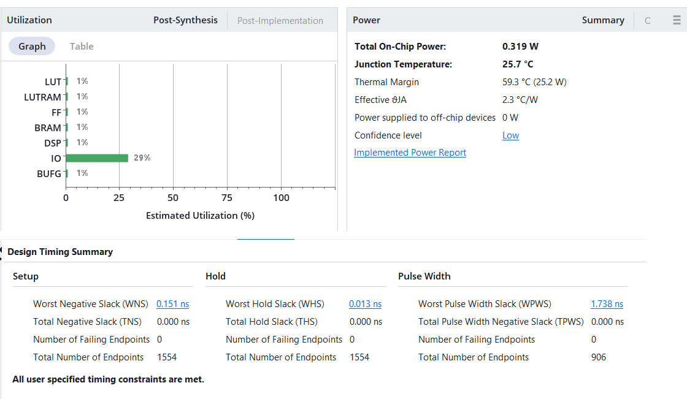
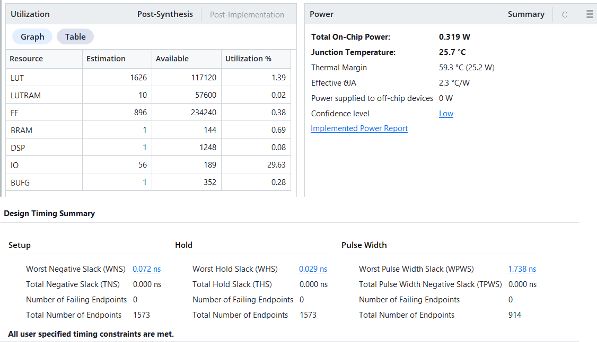
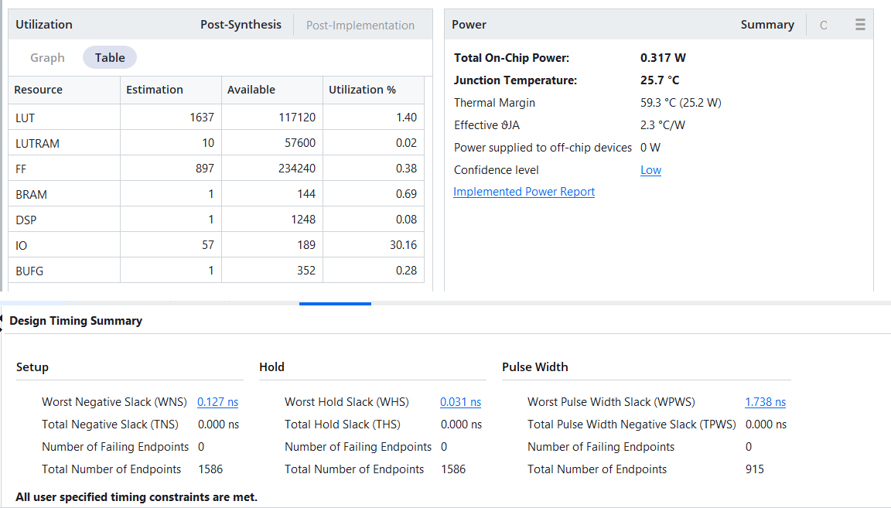
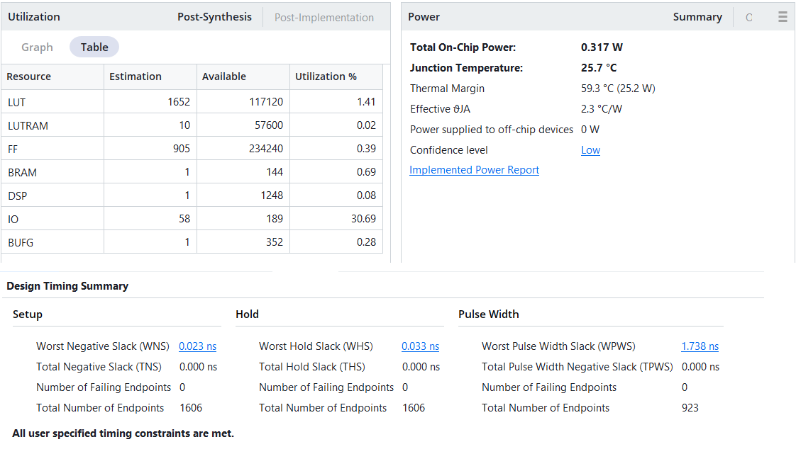

# FPGA softmax core: power, performance and area by row length

The experiment varies the maximum row length (S) from 32 to 256 on the xck26-sfvc784 FPGA. Each build sets MAX_LENGTH to S and uses the same pipelined datapath, seven-state top-level controller and 5 ns clock constraint (200 MHz). The core accepts signed INT32 scores and emits one INT8 result per input. The integrated VEXP path registers the mantissa product before shifting and rounding. All four standalone builds meet the 200 MHz constraint after routing.

## Post-synthesis resources and estimated on-chip power

| S | LUT | LUTRAM | FF | BRAM | DSP | I/O | BUFG | Power (W) |
|---:|---:|---:|---:|---:|---:|---:|---:|---:|
| 32 | 1,623 | 10 | 888 | 1 | 1 | 55 | 1 | 0.319 |
| 64 | 1,626 | 10 | 896 | 1 | 1 | 56 | 1 | 0.319 |
| 128 | 1,637 | 10 | 897 | 1 | 1 | 57 | 1 | 0.317 |
| 256 | 1,652 | 10 | 905 | 1 | 1 | 58 | 1 | 0.317 |

At the same capacity, the extra stage costs 17 flip-flops and 3–7 LUTs compared with the previous build. BRAM and DSP counts stay at one each. Vivado reported a junction temperature of 25.7 °C and Low confidence for all four power estimates. The 2 mW spread is too small to establish a trend.

## Routed timing and full-row latency

| S | Previous WNS (ns) | WNS (ns) | WNS gain (ns) | TNS (ns) | WHS (ns) | WPWS (ns) | Failing / total setup endpoints | Cycles per full row | Estimated Fmax (MHz) |
|---:|---:|---:|---:|---:|---:|---:|---:|---:|---:|
| 32 | −0.061 | +0.151 | +0.212 | 0.000 | +0.013 | +1.738 | 0 / 1,554 | 1,417 | 206.23 |
| 64 | −0.264 | +0.072 | +0.336 | 0.000 | +0.029 | +1.738 | 0 / 1,573 | 2,825 | 202.92 |
| 128 | −0.110 | +0.127 | +0.237 | 0.000 | +0.031 | +1.738 | 0 / 1,586 | 5,641 | 205.21 |
| 256 | −0.100 | +0.023 | +0.123 | 0.000 | +0.033 | +1.738 | 0 / 1,606 | 11,273 | 200.92 |

All four routed builds passed setup, hold and pulse-width checks at 5 ns. Estimated Fmax is `1000 / (5 − WNS)` MHz for a single-cycle limiting path with fixed placement and routing. Only 200 MHz was verified by the reported runs.

Cycles were measured in RTL simulation from the edge accepting `start` to the edge asserting `done`. For a full row (N = S) with continuous input and nonzero division numerators, the measured latency is **44 × N + 9 cycles**. The new stage adds one cycle per row. Each input bubble during reception adds one cycle, and each zero numerator takes the divider's special-case path, saving 30 cycles. The [functional regression](../../sim/verify_softmax.py) checks FP32 results, INT8 codes and final-element signaling across all four capacities.

## Effect of pipelining at S = 32

| RTL revision | WNS (ns) | TNS (ns) | Failing setup endpoints |
|---|---|---|---|
| Reduced buffer depth, before pipelining VEXP and the FP32 adder | −5.713 | −371.409 | 110 |
| Pipelined VEXP and FP32 adder | −1.639 | −69.787 | 80 |
| Added a three-stage INT8 quantizer and split operand preparation in the iterative divider | −0.061 | −0.360 | 14 |
| Registered the VEXP mantissa product | +0.151 | 0.000 | 0 |

At S = 32, the final revision improved WNS by 5.864 ns over the baseline and closed all 110 failing setup endpoints. A comparison of area cost and cycles per row across revisions requires equivalent measurements on the earlier designs.

## Implications for longer rows

The core accommodates longer rows with modest logic growth, while sequential accumulation and division make row latency grow roughly in proportion to S on the tested patterns. Output resolution also matters at S = 256. For a row of equal scores, each probability is 1/256 and round(127/256) produces zero for every INT8 output.

## Vivado figures

Each figure pairs the post-synthesis utilization and power views with the routed timing summary for the same build. The S = 32 image shows rounded utilization percentages. Its exact counts come from the matching post-synthesis utilization report. The latency figures come from RTL simulation. The S = 32 revision comparison uses timing summaries from the earlier implementation runs.

**S = 32.**

**S = 64.**

**S = 128.**

**S = 256.**

