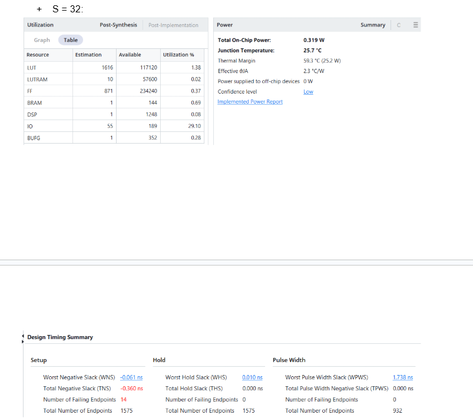
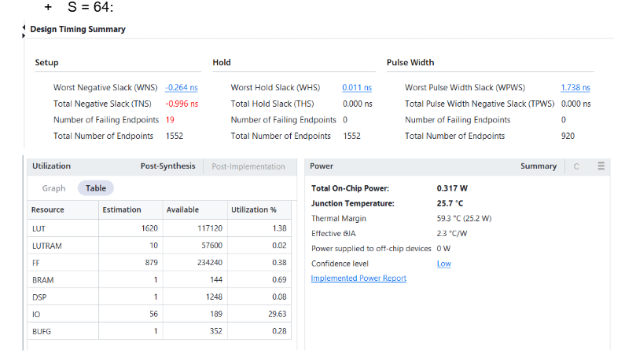
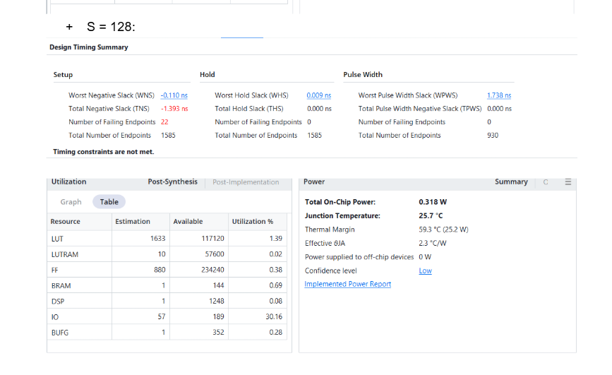
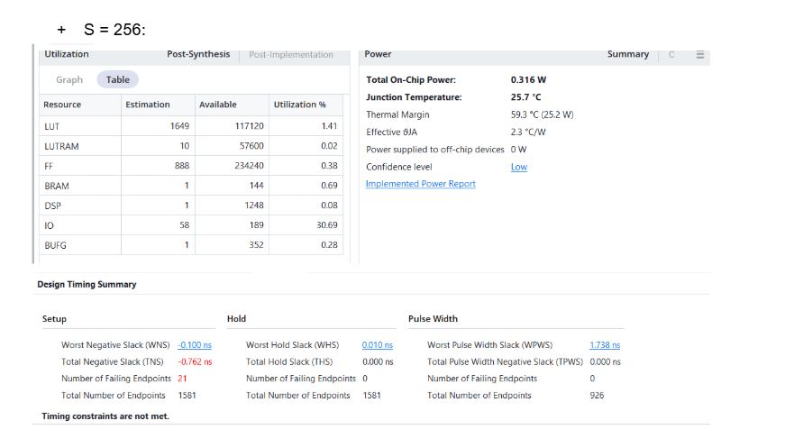

# FPGA softmax core: power, performance and area by row length

The experiment varies the maximum row length (S) from 32 to 256 on the xck26-sfvc784 FPGA. Each build sets MAX_LENGTH to S and uses the same pipelined datapath, seven-state top-level controller and 5 ns clock constraint (200 MHz). The core accepts signed INT32 scores and emits one INT8 result per input. Increasing capacity eightfold added 33 LUTs and 17 flip-flops. Full-row processing time increased almost eightfold on the simulated inputs.

## Resource utilization after synthesis

Each entry gives the resource count and its percentage of the device capacity, as reported in Vivado's Post-Synthesis view.

| Resource | Available | S = 32 | S = 64 | S = 128 | S = 256 |
|---|---|---|---|---|---|
| LUT | 117,120 | 1,616 (1.38%) | 1,620 (1.38%) | 1,633 (1.39%) | 1,649 (1.41%) |
| LUTRAM | 57,600 | 10 (0.02%) | 10 (0.02%) | 10 (0.02%) | 10 (0.02%) |
| FF | 234,240 | 871 (0.37%) | 879 (0.38%) | 880 (0.38%) | 888 (0.38%) |
| BRAM | 144 | 1 (0.69%) | 1 (0.69%) | 1 (0.69%) | 1 (0.69%) |
| DSP | 1,248 | 1 (0.08%) | 1 (0.08%) | 1 (0.08%) | 1 (0.08%) |
| I/O | 189 | 55 (29.10%) | 56 (29.63%) | 57 (30.16%) | 58 (30.69%) |
| BUFG | 352 | 1 (0.28%) | 1 (0.28%) | 1 (0.28%) | 1 (0.28%) |

LUT usage increased by 2.04% and flip-flop usage by 1.95% relative to the S = 32 build. All four builds reuse one divider across the row. The row_length port grows from six bits to nine, accounting for the increase from 55 to 58 I/O pins when softmax is the top-level design.

## Timing after routing

| S | Worst setup slack (ns) | Total negative setup slack (ns) | Failing / total setup endpoints | Worst hold slack (ns) | Worst pulse-width slack (ns) | Pulse-width endpoints | Estimated Fmax (MHz) |
|---|---|---|---|---|---|---|---|
| 32 | −0.061 | −0.360 | 14 / 1,575 | +0.010 | +1.738 | 932 | 197.6 |
| 64 | −0.264 | −0.996 | 19 / 1,552 | +0.011 | +1.738 | 920 | 190.0 |
| 128 | −0.110 | −1.393 | 22 / 1,585 | +0.009 | +1.738 | 930 | 195.7 |
| 256 | −0.100 | −0.762 | 21 / 1,581 | +0.010 | +1.738 | 926 | 196.1 |

All four builds passed hold and pulse-width checks, with zero failing endpoints and zero total negative slack in both categories. All four missed setup at 200 MHz. S = 32 came closest, missing by 61 ps. S = 64 had the worst individual setup path, while S = 128 had the largest total setup violation.

Estimated Fmax in MHz is 1,000 / (5 − WNS), using signed setup slack in ns and assuming a single-cycle limiting path with the same placement and routing. Timing closure at the estimated frequency requires verification with that clock constraint.

## Estimated on-chip power

| S | Total on-chip power (W) | Junction temperature (°C) | Thermal margin (°C) | Vivado confidence |
|---|---|---|---|---|
| 32 | 0.319 | 25.7 | 59.3 | Low |
| 64 | 0.317 | 25.7 | 59.3 | Low |
| 128 | 0.318 | 25.7 | 59.3 | Low |
| 256 | 0.316 | 25.7 | 59.3 | Low |

Vivado estimated 0.316–0.319 W across all four builds. The 3 mW spread and low confidence limit conclusions about how power varies with S. The screenshots report total on-chip power. A separate estimate would be needed to isolate the core's dynamic power.

## Full-row latency in RTL simulation

Latency was measured from the rising edge accepting start to the edge asserting done. The simulation set the DUT and testbench to the same capacity for each run. For each S, two full rows (N = S) were supplied without input bubbles: an all-zero row and a row repeating the integers −4 through 3. The Python reference and RTL testbench checked intermediate FP32 results, INT8 outputs and end-of-row signaling.

| S | Cycles per row | Row time at the 5 ns target (µs) | Mean cycles per element |
|---|---|---|---|
| 32 | 1,416 | 7.08 | 44.25 |
| 64 | 2,824 | 14.12 | 44.13 |
| 128 | 5,640 | 28.20 | 44.06 |
| 256 | 11,272 | 56.36 | 44.03 |

Both full-row patterns took 44 × N + 8 cycles, where N is the number of scores accepted for that transaction. Increasing the configured capacity alone does not add FSM iterations for a fixed N. The controller accumulates terms in order and sends each numerator to the iterative divider. A zero numerator can take the divider's shorter special-case path. The times in microseconds use the target clock period.

## Effect of pipelining at S = 32

| RTL revision | WNS (ns) | TNS (ns) | Failing setup endpoints |
|---|---|---|---|
| Reduced buffer depth, before pipelining VEXP and the FP32 adder | −5.713 | −371.409 | 110 |
| Pipelined VEXP and FP32 adder | −1.639 | −69.787 | 80 |
| Added a three-stage INT8 quantizer and split operand preparation in the iterative divider | −0.061 | −0.360 | 14 |

At the same row length and clock constraint, the two revisions improved worst setup slack by 5.652 ns and reduced failing setup endpoints from 110 to 14. A comparison of area cost and cycles per row across revisions requires equivalent measurements on the earlier designs.

## Implications for longer rows

The core accommodates longer rows with modest logic growth, while sequential accumulation and division make row latency grow roughly in proportion to S on the tested patterns. Output resolution also matters at S = 256. For a row of equal scores, each probability is 1/256 and round(127/256) produces zero for every INT8 output.

## Vivado figures

The following figures are the four user-supplied Vivado screenshots used for the resource, timing and power tables. The latency figures come from RTL simulation. The S = 32 revision comparison uses timing summaries from the earlier implementation runs.

**S = 32.**

**S = 64.**

**S = 128.**

**S = 256.**

