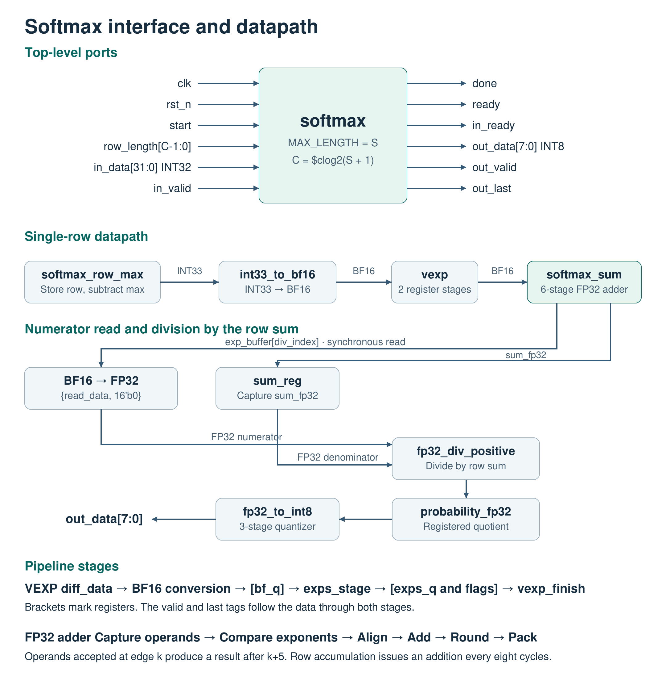
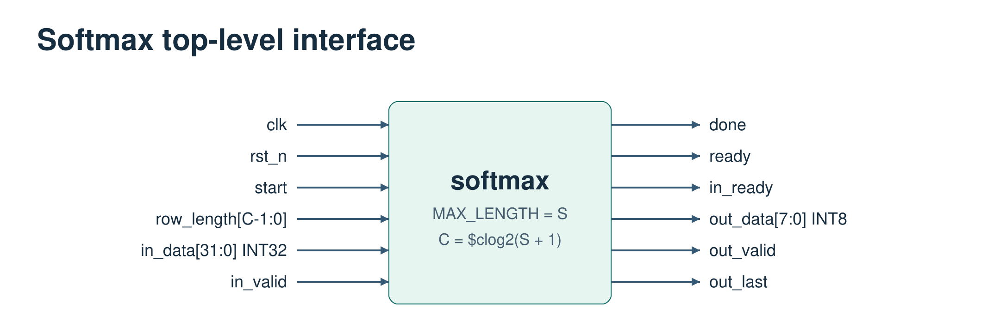
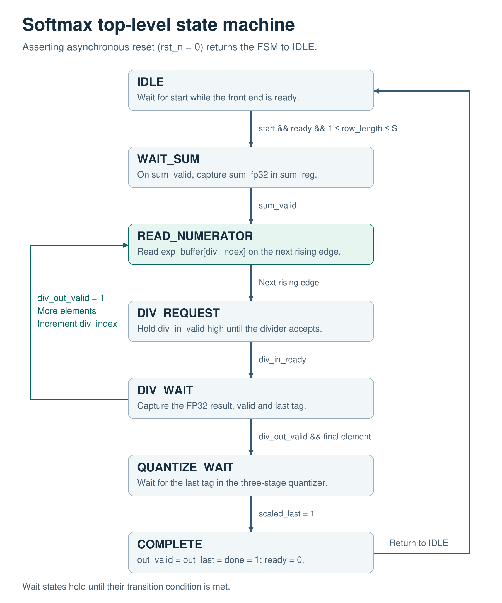

# RTL architecture specification for the INT32-to-INT8 softmax core

**Revision 1.5 · 14 November 2026**  
**Top module:** `softmax`. **Target clock:** 5 ns (200 MHz). **Current top-level parameter:** `MAX_LENGTH=256`. The detailed regression results use the S = 32 reference build. Throughout this specification, S denotes configured capacity and N denotes the length of the current row.

## 1. Scope and configuration

The core consumes one row of signed INT32 scores, subtracts the maximum for numerical stability, approximates the exponential in BF16, sums and divides in FP32, and emits quantized INT8 probabilities in input order. Each accepted start launches one row. The transaction ends with the final valid output of that row.

| Parameter or property | Value |
|---|---|
| Row capacity S | Build-time parameter MAX_LENGTH. Evaluated capacities are 32, 64, 128 and 256. |
| Count width C | `$clog2(MAX_LENGTH+1)`. The four builds use 6, 7, 8 and 9 bits respectively. |
| Transaction length N | 1 through MAX_LENGTH inclusive, latched on row acceptance |
| Input scale | Each input code is interpreted directly as an integer score with unit scale. |
| Output encoding | Signed INT8 codes 0 to 127. Decode a code q as q/127. |
| Clock and reset | One rising-edge clock and an asynchronous active-low control reset |
| Output flow control | The consumer must accept every valid output. |

Input scale determines the arguments to the exponential. The output factor of 127 determines probability resolution. Application-level accuracy depends on both.

## 2. Single-row architecture



*Figure 1. The numerator comes from a synchronous read of exp_buffer. Every division in a row uses the same denominator held in sum_reg.*

The core stores the incoming row while finding its maximum. After the last input, it reads the row, subtracts the maximum and writes one BF16 exponential per element to a second buffer. It then accumulates the exponentials, reads them again as numerators, and emits the quantized quotients. This organization requires one external input pass per row.

## 3. Arithmetic and number formats

For each input row, the bit-level reference follows these operations in order:

```text
m          = max(x)
d[i]       = signed_INT33(x[i]) - signed_INT33(m)
b[i]       = BF16_RNE(d[i])
e[i]       = VEXP_approx(b[i])
sum[0]     = FP32(0)
sum[i+1]   = FP32_RNE(sum[i] + BF16_to_FP32(e[i]))
p[i]       = FP32_RNE(BF16_to_FP32(e[i]) / sum[N])
q[i]       = clamp(RNE_integer(FP32_RNE(p[i] * 127)), 0, 127)
```

RNE means round to nearest, with ties resolved to the even result. Subtraction precedes BF16 conversion to preserve differences between nearby large INT32 scores. VEXP implements its own exponential approximation.

| Quantity | Encoding | Range or interpretation |
|---|---|---|
| x, maximum | Signed INT32 | −2³¹ through 2³¹−1 |
| Difference | Signed INT33 | −4,294,967,295 through 0 |
| Converted difference and exponential | BF16 | 1 sign, 8 exponent and 7 fraction bits, bias 127 |
| Sum, numerator, denominator and probability | FP32 | 1 sign, 8 exponent and 23 fraction bits, bias 127 |
| Quantized result | Signed INT8 | Codes 0 through 127 |
| Row count | Unsigned C bits | Must represent N itself. Valid element indices run from 0 through N−1. |

Appending 16 zero bits to a BF16 encoding gives its exact FP32 representation. At least one score equals the row maximum, so one exponential equals 1. All exponentials lie in [0, 1] on the valid softmax path, giving a denominator in [1, N].

**Special cases.** Standalone VEXP maps zero and subnormal inputs to BF16 one, NaN to 0x7FC0, positive infinity to infinity and negative infinity to zero. Tiny outputs flush to zero. The positive FP32 divider handles subnormals, underflow and overflow. Zero divided by zero and infinity divided by infinity produce NaN. Positive finite values divided by zero produce infinity. Finite values divided by infinity produce zero. Negative nonzero operands and NaN inputs produce NaN. Signed zero is treated as zero. The interface exposes results without exception flags.

The quantizer maps negative inputs and NaNs to 0, and positive infinity or a probability at least 1 to 127. Both rounding operations matter. Two probabilities of 0.5 produce [64, 64], whose codes sum to 128. For a uniform row of 32 elements, every code equals 4. For a uniform row of 256, every code equals 0.

## 4. Top-level ports and protocol



*Figure 2. S is the configured row capacity. The input `row_length[C-1:0]` carries the actual row length from 1 through S, so its width must include S itself.*

| S (`MAX_LENGTH`) | C (`COUNT_WIDTH`) | Input port |
|---:|---:|---|
| 32 | 6 | `row_length[5:0]` |
| 64 | 7 | `row_length[6:0]` |
| 128 | 8 | `row_length[7:0]` |
| 256 | 9 | `row_length[8:0]` |

| Port | Direction | Bits | Contract |
|---|---|---:|---|
| clk | Input | 1 | Common rising-edge clock |
| rst_n | Input | 1 | Low aborts the current row |
| start | Input | 1 | Request a new row, normally with a one-cycle pulse |
| row_length | Input | C | Present N at the rising edge accepting start |
| ready | Output | 1 | Top is idle, front end is ready and reset is released |
| in_data | Input | 32 | One signed INT32 score |
| in_valid | Input | 1 | Source presents a valid score |
| in_ready | Output | 1 | Receiver can accept one score |
| out_data | Output | 8 | Signed INT8 probability code, sampled with out_valid |
| out_valid | Output | 1 | One output element is valid |
| out_last | Output | 1 | Accompanies the final valid element of the row |
| done | Output | 1 | out_valid && out_last |

1. Accept a row at a rising edge with ready, start and a valid N. The first score is accepted on a subsequent edge.
2. Accept a score on each rising edge with in_valid && in_ready. The source holds its valid score until acceptance. Input bubbles extend row latency.
3. After N transfers, the core stops accepting inputs. The top stays busy while the front end and divider complete the row.
4. Capture each result with out_valid. The output has no out_ready port. A consumer that can stall must provide storage or reserve write capacity before starting the row.
5. The last result asserts out_valid, out_last and done together while ready is low. Ready returns after the next edge. Holding start high until ready returns requests another row.
6. Invalid lengths are ignored in IDLE. Reset clears transaction state and valid tags. A fresh start and complete row are required after reset.

## 5. Module hierarchy and interfaces

```text
softmax
├── u_front : softmax_exp_sum
│   ├── u_exp : softmax_exp
│   │   ├── u_row : softmax_row_max
│   │   ├── u_convert : int33_to_bf16
│   │   ├── u_exps : exps_stage
│   │   └── u_finish : vexp_finish
│   │       └── u_px : px
│   └── u_sum : softmax_sum
│       └── u_add : fp32_add_positive
├── u_div : fp32_div_positive
└── u_quantize : fp32_to_int8
```

Widths in brackets below denote bit counts. Sequential blocks share clk and rst_n. Unqualified control signals are one bit.

| Block | Input signals | Output signals | Function |
|---|---|---|---|
| softmax_row_max | start, row_length[C], in_valid, in_data[32] | in_ready, done, max_value[32], diff_data[33], diff_valid | Store scores, find maximum and stream differences |
| int33_to_bf16 | in_data[33] | out_bf16[16] | Combinational normalization and RNE |
| vexp | x_in[16] | exp_out[16] | Standalone combinational version for verification |
| softmax_exp | start, row_length[C], in_valid, in_data[32] | in_ready, done, max_value[32], exp_data[16], exp_valid | Registered VEXP stream with aligned final-element flag |
| softmax_sum | start, row_length[C], exp_data[16], exp_valid, exp_last, read_index[C] | ready, sum_fp32[32], sum_valid, read_data[16] | Buffer exponentials, accumulate and supply numerators |
| fp32_add_positive | in_valid, a[32], b[32] | in_ready, result[32], out_valid | Six-stage nonnegative FP32 adder |
| softmax_exp_sum | start, row_length[C], in_valid, in_data[32], read_index[C] | ready, in_ready, sum_valid, sum_fp32[32], read_data[16] | Front end and public numerator read port |
| fp32_div_positive | in_valid, numerator[32], denominator[32] | in_ready, result[32], out_valid | Iterative direct division, one request in flight |
| fp32_to_int8 | in_valid, in_data[32] | out_data[8], out_valid | Three-stage probability quantizer |

In vexp.sv, exps_stage returns a 16-bit intermediate and three flags for NaN, infinity and zero. The px block uses seven intermediate fraction bits to produce a seven-bit correction. vexp_finish selects the final encoding, including special values. The coefficients are LOG2E = 23637, GAMMA_1 = 422 and GAMMA_2 = 278.

## 6. Datapath and storage

**Row capture and exponential.** The first accepted score initializes the maximum so that all-negative rows work correctly. READ_ROW primes the synchronous row-buffer read. The core subsequently produces N consecutive INT33 differences. If a difference becomes valid after edge k, bf_q holds its converted value after k+1 and exps_q holds the intermediate after k+2. vexp_finish produces the exponential from that intermediate. Valid and the final-element flag follow both stages.

**Accumulation.** In RECEIVE, each valid exponential writes exp_buffer[received_count]. The FSM ends reception by counting to the latched row length. A simulation assertion checks that exp_last agrees with the count. After the entire row has arrived, the summation FSM visits addresses in order. The adder stages capture operands, compare exponents, align mantissas, add, round and pack. A pair accepted at edge k produces out_valid after k+5. Independent pairs can enter on consecutive cycles. For a single row, the accumulator feedback and ADD_READ, ADD_REQUEST and ADD_WAIT states space requests eight cycles apart.

**Division.** When sum_valid asserts, the top captures sum_fp32 in sum_reg. READ_NUMERATOR issues a synchronous read at div_index. The public read port returns zero for an invalid location. The divider takes the FP32-expanded numerator and the saved denominator. It decodes and normalizes its operands, prepares the quotient exponent and initial remainder, then iterates, rounds and packs. The top captures each valid quotient in probability_fp32.

**Quantization and final tag.** The three stages compute the product by 127, round the scaled value to FP32, then round to an integer and clamp. An input accepted at edge k produces out_data and out_valid after k+2. The last tag follows product_last, scaled_last and out_last. QUANTIZE_WAIT advances when scaled_last is asserted. COMPLETE coincides with the final valid INT8 result.

| Storage | Logical size | Use |
|---|---|---|
| row_buffer | S × 32 bits | Retain scores for subtraction |
| exp_buffer | S × 16 bits | Reuse exponentials for summation and division |
| accumulator and sum_reg | 32 bits each | Running sum and saved denominator |

At S = 32, the arrays contain 1,024 and 512 bits respectively. At S = 256 they contain 8,192 and 4,096 bits. Physical RAM allocation depends on device mapping and is reported separately in the PPA results.

## 7. Top-level FSM and cycle timing



*Figure 3. The controller returns to READ_NUMERATOR for each remaining element. On the last element it waits for the quantizer to align its output and last tag.*

| State | Action | Transition |
|---|---|---|
| IDLE | Capture N, clear the index, pulse stage_start | Valid start with front end ready → WAIT_SUM |
| WAIT_SUM | Wait for the front end to receive, exponentiate and sum the row | sum_valid → capture sum_reg and enter READ_NUMERATOR |
| READ_NUMERATOR | Sample the numerator address in synchronous RAM | Next edge → DIV_REQUEST |
| DIV_REQUEST | Hold division request valid | div_in_ready → DIV_WAIT |
| DIV_WAIT | Capture the quotient on div_out_valid | More elements → increment index and return to READ_NUMERATOR. Final element → QUANTIZE_WAIT |
| QUANTIZE_WAIT | Drain the final quantizer result | scaled_last = 1 → COMPLETE |
| COMPLETE | Emit final INT8 with out_valid, out_last and done | Next edge → IDLE |

Normal division completes 31 cycles after the acceptance edge. Special cases, including a zero numerator with a positive denominator, complete one cycle after acceptance. Reset returns the top to IDLE and discards pending valid tags.

For a three-element row, the transaction order is **start → accept x0, x1, x2 → emit q0, q1, q2 → ready**. Only q2 carries out_last and done. Gaps between results depend on the divider.

## 8. Clock and reset

All internal transfers use the rising edge of clk. Active-low reset aborts the row. The controller invalidates buffered contents through counters and valid bits, so reset does not require clearing RAM. The target period is 5 ns. Section 10 records measured setup slack.

## 9. Verification and acceptance criteria

The top-level testbench defaults to S = 32 and passes its MAX_LENGTH parameter to the DUT. A separate capacity sweep checked seven rows per build, including lengths S−1 and S, against the reference. For S = 32, 64, 128 and 256 respectively, all 163, 323, 643 and 1,283 INT8 codes and intermediate FP32 quotients matched. Each row asserted out_last and done only on its final valid result.

The Python reference computes exact integer differences, BF16 conversion, approximate VEXP and sequential FP32 sums. Its division oracle rounds the exact quotient to FP32. Quantization is checked against quantize_int8. A reciprocal followed by multiplication can produce a different rounded answer.

| S = 32 regression at a 5 ns simulation period | Recorded result |
|---|---|
| End-to-end comparisons | 80 rows and 1,133 INT8 outputs. All checked codes and internal FP32 results matched. |
| Protocol | Valid, last and done alignment passed. Tests cover bubbles, busy starts, invalid lengths and reset during reception, summation, division and quantization. |
| Maximum absolute error of q/127 against mathematical softmax | 0.00431882259605 |
| Mean absolute error | 0.000430389065547 |
| Maximum absolute deviation of the decoded row sum from one | 0.0551181102362 |

Block regressions covered 10,151 FP32 additions, 28 row sums, 13,594 divisions and 38,639 FP32-to-INT8 conversions. The VEXP stream matched 1,020 values across 71 rows. Standalone VEXP matched the bit-level model for all 65,536 BF16 encodings. The Python unit suite passed 31 tests.

For input [2, 1, 0], differences are [0, −1, −2], exponentials are [1, 0.369140625, 0.1357421875] and the sum is 1.5048828125. The approximate probabilities [0.664503574, 0.245295256, 0.090201169] quantize to [84, 31, 11].

A passing row produces exactly N ordered results and one completion pulse.

## 10. FPGA implementation and performance

Vivado 2026.1 targeted xck26-sfvc784, speed grade −2LV, at 5 ns. At S = 32, the final build used 1,616 LUTs, 871 flip-flops, one BRAM and one DSP after synthesis. The final routed WNS was −0.061 ns at S = 32 and −0.100 ns at S = 256. All four reported configurations passed hold and pulse-width checks and missed setup at 200 MHz. Full measurements, power confidence and workload assumptions are in the [English PPA report](PPA_Report.md).

| S = 32 revision | WNS (ns) | TNS (ns) | Failing setup endpoints |
|---|---:|---:|---:|
| Before pipelining VEXP and the FP32 adder | −5.713 | −371.409 | 110 |
| After pipelining VEXP and the FP32 adder | −1.639 | −69.787 | 80 |
| After staging quantization and divider preparation | −0.061 | −0.360 | 14 |

In the baseline softmax_setup.rpt, eight of the ten worst paths ran from exp_buffer to the adder result. The worst traversed 33 logic levels in 9.631 ns. Two ran from diff_data through BF16 conversion and VEXP to the RAM write port, with a worst delay of 10.962 ns and slack of −5.709 ns. Baseline WHS was +0.022 ns.

In the intermediate softmax_setup_pipeline.rpt, two of the ten worst paths reached the INT8 output register. The worst took 7.191 ns across 24 levels (3.055 ns logic, 4.136 ns routing). Eight ran from the divider denominator register to quotient_exp. Their worst slack was −1.618 ns across 23 levels (3.437 ns logic, 3.507 ns routing). The intermediate build had 80 failing setup endpoints out of 1,337, WHS +0.014 ns and worst pulse-width slack +1.738 ns. These path descriptions refer to their respective revisions.

## Appendix A. RTL sources and clock constraint

Set the synthesis top to softmax. Design sources are softmax.sv, softmax_exp_sum.sv, softmax_exp.sv, softmax_row_max.sv, int33_to_bf16.sv, vexp.sv, softmax_sum.sv, fp32_add_positive.sv, fp32_div_positive.sv and fp32_to_int8.sv. Place testbenches in simulation sources. The clock constraint is `create_clock -name clk -period 5.000 [get_ports clk]`.
